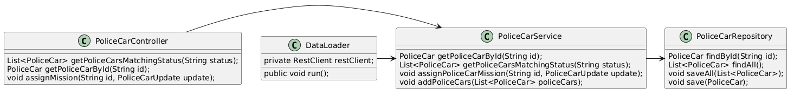
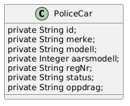

# Politibiler

Due to the context of this task, this README assumes the reader knows Norwegian. 

## Requirements

The application requires JDK 21 installed in order to run

## Getting started

Enter the policecars folder  
`cd policecars`  

Install system dependencies  
`mvn clean install`  

Run the Spring Boot application  
`mvn spring-boot:run`

## API

### Retrieving all available police cars

http://localhost:8080/politibiler?status=Tilgjengelig

### Retrieving police car by id

http://localhost:8080/politibiler/{id}

### Updating mission and status for police car by id
http://localhost:8080/politibiler/{id}

With the body below. Remember to swithc out newMission and newStatus with the new police car mission and status

{
    "oppdrag": "newMission",
    "status": "newStatus"
}

## Work methodology

I started by thoroughly reading the task and making up my mind regarding how to approach the task. This process is described in the [before-coding document](docs/before-coding.md). I had created simple systems like this one in Spring Boot before, and knew it would require a Controller describing the system interface, a service handling the controllers needs, and the repository acting as the middleman between the database and the rest of the system. I wanted to use SQLite as it is simple has minimal setup, making it suitable for a small system for a job interview. The system would also need a class to retrieve data from the dummy api-endpoint. This is the DataLoader class. The architecture of the system is shown below. The diagram type is not the best, but I think it does an ok job of showcasing the system. 

The police car class is shown in the diagram below. Note that the field names are in Norwegian, as the original data was in Norwegian. 

I started the coding with setting up the project using Spring Initializr, and creating the classes I knew I would need. I now had a skeleton for the system. I created functionality for retrieving data first, as this would be an easy task and would help me touch up on my Spring Boot skills, as I have not used it for months. I then created the DataLoader class for retrieving dummy data. This would make me able to test the API from the rest controller using a http client. Lastly, I made the API endpoint for updating a police cars status. I also created a cors configuration, so that the API will be accessible from a website runnig in a web browser. 

After most of the system was in place, I created the tests for the system. I have unit tests, which can be found in the [test folder](policecars/src/test/java/no/eskildveren/policecars/). [httpclient-testing.json](httpclient-testing.json) described the tests used by the http client, and can be tested using [Httpiness](https://github.com/bognikol/httpiness). Httpiness is far from standard, but I enjoy its simplicity compared to other tools such as Postman. For testing the cors settings, I vibe coded a website which will retrieve all available police car from the API. 

## AI Usage

Claude has been used for assitance to build this project. I asked for help when setting up the project and met confusing errors. I also needed some help to get started with the testing, as I was unsure about the syntax. 

## Assumptions

These are the assumptions made when creating the project

### Choosing status when assigning a mission

Looking at the dummy data, the same mission (oppdrag) does not always have the same status. Two of the cars has mission "Trafikkulykke", but one has "På vei til hendelse" as status, while the other has "I oppdrag". Another observation is that many cars has one of two common statuses, "Tilgjengelig" or "I oppdrag". I will therefore use "I oppdrag" as the default status when assigning a mission. The system should also allow the API user to assign a custom status, though that will be optional. That is unless the assigned mission is an empty string, in which case I will assign the car "Tilgjengelig" as the default status. 

### Handling language

The code for the repository will mainly be in english, though for properties in the PoliceCar and PoliceCarResponse classes are in Norwegian. This is because I wanted to match the original format of the data for consistency reasons. It would be confusing if the police cars are modelled in Norwegian in most systems, while being in English in this system.

### Usage of Enums

Enums was not used, as I lack the domain knowledge to create them. Though I think that fields such as status, oppdrag, modell and merke could use them. 

### ID will always be a numeric ID

This is because it matches the data from the API endpoint, and makes the system easier to develop. This is useful for the chosen method of sorting ids. 

### Oppdrag cannot be null

I made this assumption due to there being no occurance of this in the dummy data. That decision could change if I had more domain knowledge or knowledge of the system. I did not set up a lot of time philosophizing about this due to this just being a short task. 

## Folder structure

I like to grow the folder structure naturally over time. Since the project does not have a lot of classes, I have not created a lot of folders. If I had more of one type of class, I would have created more folders. That can be seen in the model folder, which contains three classes of a similar purpose. 

## Testing

The application uses unit testing with Junit, with the components being mocked using Mockito. The Httpclient tool [Httpiness](https://github.com/bognikol/httpiness) was used for this purpose, and the file containing the requests is in [httpclient-testing.json](httpclient-testing.json). The [cors-test](cors-test) frontend is there to test that the CORS configuration was correctly set up. It tests that the website is able to make a request to get all available police cars. It is 100% ai generated, as I found writing it out of scope regarding what I should spend time on. 